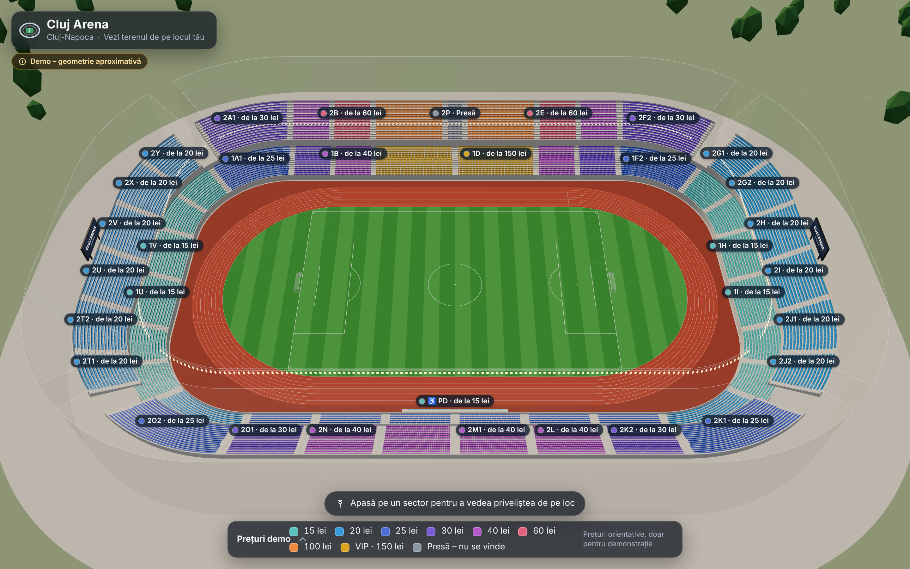
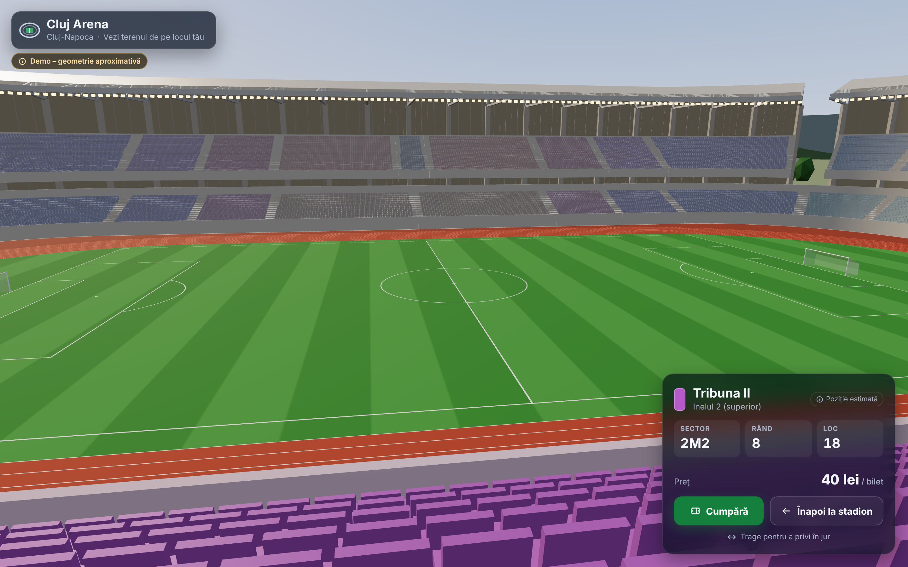

# Cluj Arena — "view from your seat" (sales demo)

A browser demo of a 3D ticketing experience: see the whole stadium, tap a
sector, fly to a seat in it, look around from that seat, and open a clearly
fake checkout. UI in Romanian.

> **Demo only.** Geometry is approximate (see [reference/FACTS.md](reference/FACTS.md)),
> prices are demo prices, and the checkout takes no payment. No official logos or
> trademarks are used, and no third-party photos are shipped. All geometry is procedural.

| Overview | Seat view |
|---|---|
|  |  |

## Run locally

Requires Node ≥ 22.18 (the authoring scripts run TypeScript directly).

```bash
npm install
```

```bash
npm run dev
```

Open http://localhost:5173. Useful URL parameters:

- `?fps`: on-screen frame-rate meter (measure on the real demo laptop/phone)
- `?venue=example-arena`: the second, fictional venue

Checks:

```bash
npm test
```

```bash
npm run build
```

```bash
npm run e2e
```

`npm run e2e` builds the app, serves it with `vite preview` and runs Playwright
(real taps on a sector in each stand at 1440×900 and 390×844, screenshots into
`screenshots/`, console-error check, FPS measurement). It uses the Chromium that
matches `@playwright/test`; on a fresh machine install it once with
`npx playwright install chromium`.

## Project layout (short)

```
venues/*.json        venue data (stands → rings → sectors → rows)
scripts/             authoring scripts that produced the estimated venue data
src/venue/           zod schema + validation (fail fast) + loader
src/geometry/        pure TypeScript generator: seats, structure buffers, sightlines (+ tests)
src/scene/           React Three Fiber rendering
src/camera/          camera poses, flights, look-around (+ tests)
src/interaction/     sector tap/hover handling, e2e test seam
src/ui/              Romanian overlay (header, legend, seat panel, fake checkout)
src/state/store.ts   the one small app store
e2e/                 Playwright specs
reference/           research notes: what is sourced vs. estimated
```

Read [ARCHITECTURE.md](ARCHITECTURE.md) for how it works and why, [PLAN.md](PLAN.md)
for the original plan, [DECISIONS.md](DECISIONS.md) for every significant
decision, and [REPORT.md](REPORT.md) for results and the on-site checklist.

## Add a new venue

1. Create `venues/<id>.json` (kebab-case id). The format is defined by
   [`src/venue/schema.ts`](src/venue/schema.ts):
   - `layout.referenceLine`: the front edge of the stands as a rounded rectangle
     (`halfLength`, `halfWidth`, `cornerRadius`; semicircular ends = `cornerRadius` equal to `halfWidth`);
   - `stands[] → rings[] → sectors[] → rows[]`. A sector covers `span.from … span.to`
     metres of arc length along that line (0 = middle of the −z side, increasing
     clockwise seen from above). Each row has `seats`, `distance` (metres behind the
     reference line), `elevation` (tread height) and `rakeDeg`;
   - `capacity` totals must equal the sum of the rows; `priceTiers`, `pitch`,
     optional `track`, `roof`, `facade`, `screens`, `floodlights`.
2. Easiest: copy [`scripts/author-example-arena.ts`](scripts/author-example-arena.ts),
   change the parameters, and run it with `node scripts/<your-script>.ts`. It
   computes how many seats fit per row and validates the result before writing.
   Real seat counts from a ticketing system can then replace the `seats` values.
3. Run `npm test`. Every venue in `venues/` is checked automatically: seat
   count = capacity, no two seats closer than a seat width, and every seat
   sees the pitch centre and the nearest touchline over the heads in front
   (C-value ≥ `minCValue`). If the data is wrong, the test names the sector.
4. Open `http://localhost:5173/?venue=<id>`. An invalid config shows its validation
   errors on screen instead of a broken scene.

## Deploy to Vercel

Static site, no backend. Vercel detects Vite automatically.

- Dashboard: *Add New → Project*, import the repository, framework preset
  **Vite**, build command `npm run build`, output directory `dist`. Deploy.
- CLI:

```bash
npx vercel
```

```bash
npx vercel --prod
```

The committed `.npmrc` (`legacy-peer-deps=true`) is required. Without it, npm 10
crashes resolving vitest's optional peer dependencies (see DECISIONS.md #13).
Vercel picks it up automatically.
