# REPORT — Cluj Arena "view from your seat" sales demo

**Status: complete and verified.** All 85 unit tests and 7 end-to-end tests pass;
the typecheck and `npm run build` pass; there are zero console errors. An
independent reviewer agent (fresh context, did not write the code) checked
the build against the spec and tried to break it; its findings were fixed or
documented (see §5). Everything is committed and pushed on
`claude/relaxed-galileo-5jqhby`.

> **Read first:** every geometric value is an **estimate**. The build
> environment could not open any reference website or photo (only a search
> engine's text excerpts were reachable), so the stadium has not been checked
> against a plan or a photo. The checklist in §6 is what to verify at
> the stadium before calling it "Cluj Arena" in front of the venue's managers.

## 1. What works

| Brief | Result |
|---|---|
| Overview in 3D, from above at an angle | ✓ Framed for the screen shape: a laptop looks at the main stand (VIP, press and 100-lei sectors visible), a phone looks along the long axis. Drag to orbit, wheel/pinch to zoom (limited). |
| Sectors coloured by price tier, labelled "de la X lei" | ✓ 9 demo tiers plus press. Labels are ranked by commercial value, so premium sectors are always labelled: 50/58 labels on a 1440×900 laptop, 35/58 on a 390×844 phone (the hidden ones are the cheapest lower-ring sectors; their price shows on hover and in the seat panel). |
| Tap → highlight → ~1.5 s eased flight to a representative seat | ✓ 1.5 s ease-in-out cubic flight. It never passes through the roof or the stands (tested for all 58 sectors, all 3,306 seat-to-seat pairs and mid-air retargets). Other sectors turn grey. |
| Seat view at eye height, limited look-around, stand/sector/row/seat/price, back, pick another sector | ✓ Eye 1.2 m above the tread. Drag to look: ±75° yaw, −50°…+20° pitch. Seat panel shows all fields, "Înapoi la stadion". Tapping another sector from the seat flies straight there. The phone's back gesture also returns to the overview. |
| "Cumpără" → clearly fake checkout | ✓ "Demo – fără plată reală" banner, 1–4 adjacent seats, total, demo confirmation. No payment or personal-data fields. Disabled for the press sector. |
| Romanian UI, "Cluj Arena", "Demo – geometrie aproximativă", no logos | ✓ Including the error and fallback screens. No club names, crests or sponsor marks anywhere. |
| Laptop and phone | ✓ 1440×900, 390×844 portrait, and phones in landscape (compact layout). Adaptive resolution for slower devices. |
| Robust to fast repeated taps | ✓ Each new tap retargets the flight from the camera's current pose: no queue, no snapping, the last tap wins (e2e-tested). |
| Venue-agnostic generator with an extension point | ✓ A second, fictional venue (`?venue=example-arena`: football-only, one ring, no track) renders and passes the same invariant tests. The theatre ("horseshoe") extension point and its real scope are in ARCHITECTURE §9. |
| Invalid config fails fast | ✓ zod plus semantic checks; messages name the JSON path and the sector. The app shows the errors instead of a broken scene. |

## 2. Screenshots

All from Playwright on the production build. "Seat" screenshots were taken
after a **real tap** on the sector in the overview and the camera's arrival.

| | Laptop 1440×900 | Phone 390×844 |
|---|---|---|
| Overview | 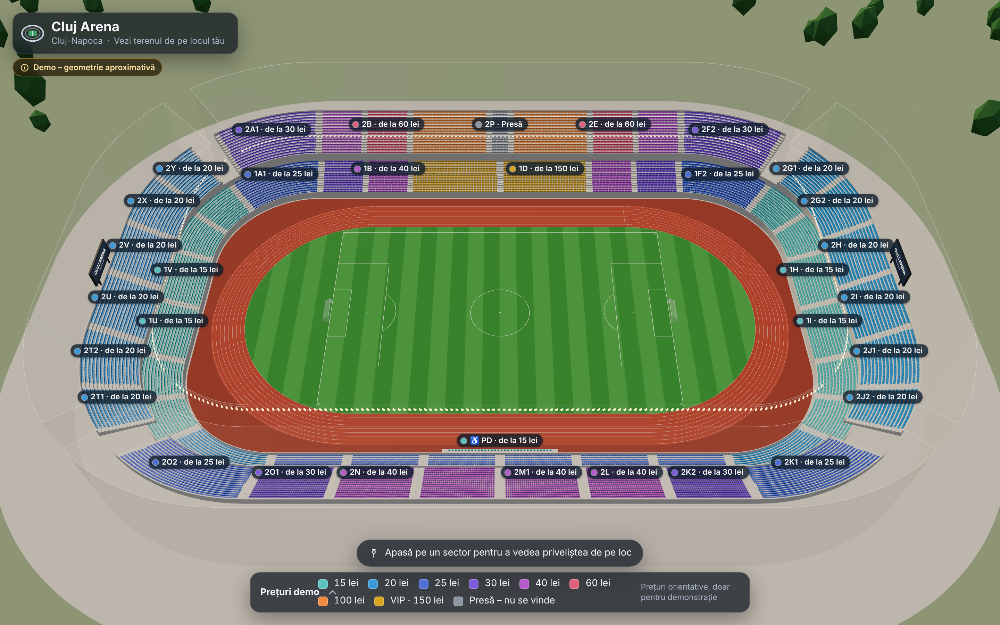 | 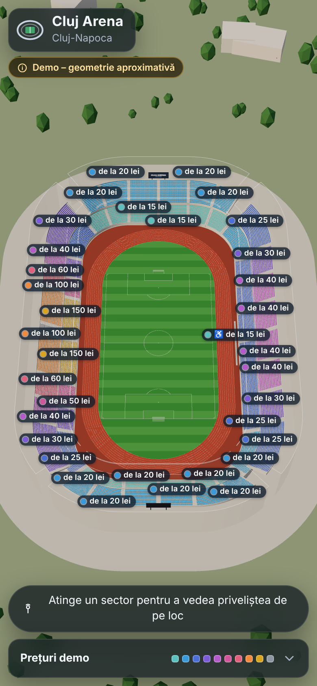 |
| Tribuna I · 2C (100 lei) | 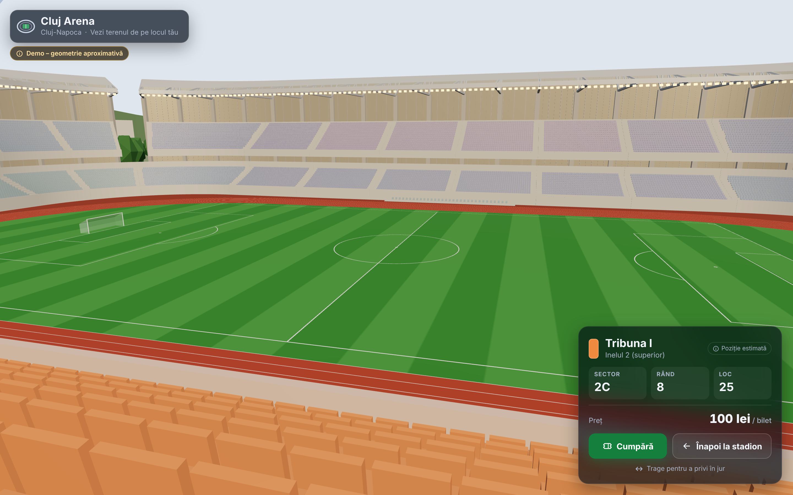 |  |
| Peluza II · 1H (lower ring) | 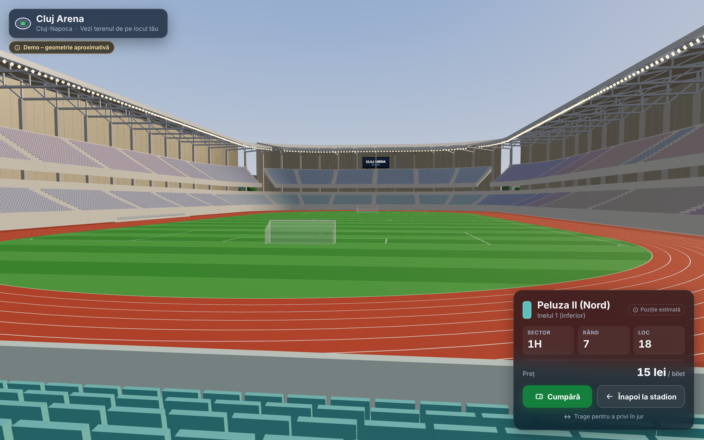 | 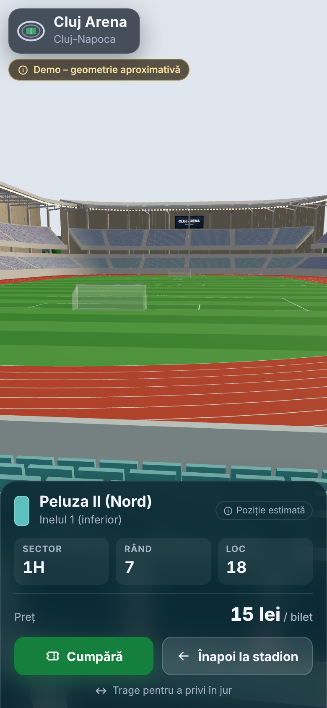 |
| Tribuna II · 2M2 | 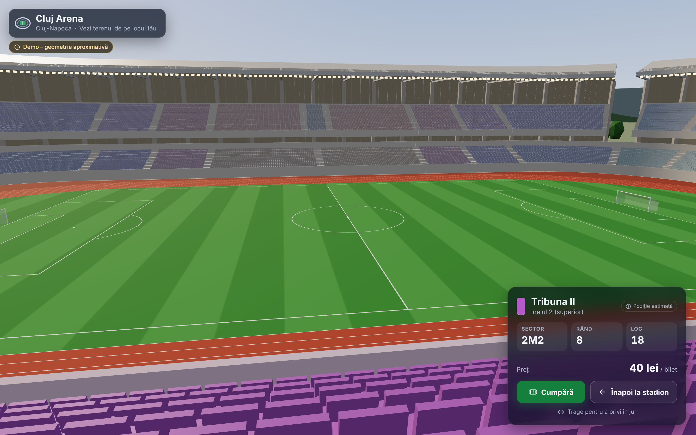 | 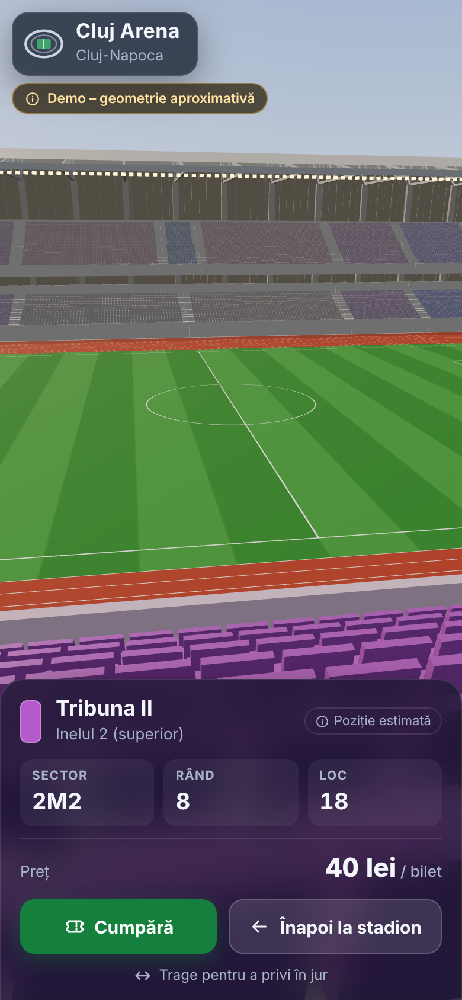 |
| Peluza I · 2V | 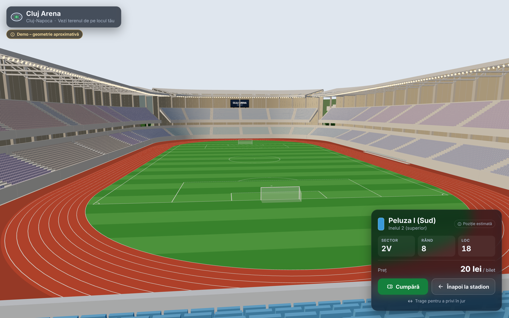 |  |
| Fake checkout | 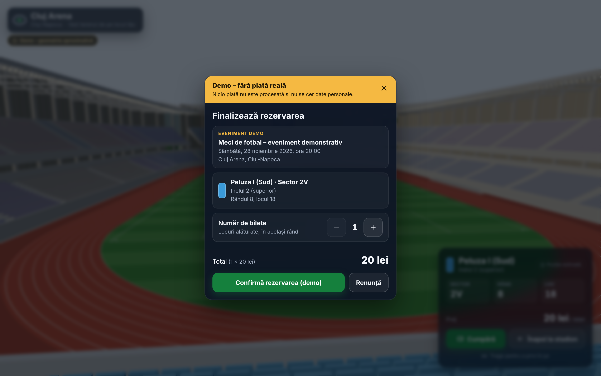 | 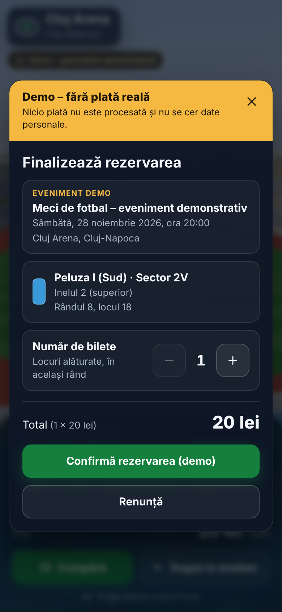 |

Extra: corner sector at the roof gap 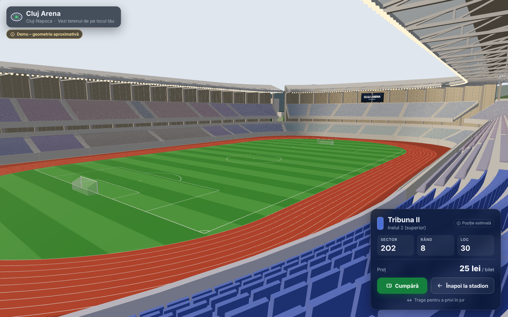,
phone in landscape 
, and the second venue
. The landscape and second-venue
shots are manual Playwright captures from the dev server.

## 3. Performance (overview, all 30,335 seats rendered)

| Measured in this environment (headless Chromium, **SwiftShader = CPU rendering, 4 cores**) | DPR 1 | DPR 2 |
|---|---|---|
| Frames per second | **4.0** | **1.75** |
| p95 frame time | 317 ms | 700 ms |
| **Our JavaScript per frame** (CDP `ScriptDuration`) | **1.8 ms** | **2.1 ms** |
| Main-thread time per frame (mostly waiting for the software rasteriser) | 283 ms | 799 ms |
| Draw calls / triangles | 89 / 158,298 | 89 / 158,298 |

**How to read this:** this container has no GPU, so every pixel is rasterised
on the CPU. Those fps numbers are a floor and say nothing about a laptop. What
does transfer to real hardware:

- **Our CPU cost is ~2 ms per frame**, about 12 % of a 60 fps budget.
- **The GPU load is small:** 89 draw calls and ~160k triangles in the overview
  (seat LOD: 4-triangle seats when far, 20 when near), plus about 645k
  triangles in the seat view. A mid-range laptop GPU handles this many times
  over.
- **Fill rate is what scales with screen density** (DPR 2 ≈ ½ the fps of DPR 1
  here). That's why the resolution adapts on slow devices.

**Please measure on the demo hardware:** open the deployed site with `?fps`
(e.g. `https://<your-app>.vercel.app/?fps`). A meter shows fps and the worst
frame. I could not measure a real GPU here, so I don't claim "60 fps". The
design target is that, and the numbers above are why I expect it.

## 4. Test results

**Unit tests (vitest): 85 passed, 9 files.**

| Area | What is checked |
|---|---|
| Seat count | generated seats = the sum of the rows = `capacity.total` = **30,335**; VIP **1,464**, press **168**, wheelchair **32**; unique ids; sectors contiguous |
| Seat spacing | no two seats closer than their seat width (spatial hash over all 30,335 seats, 1 mm tolerance for curved rows) |
| Sightlines | **every seat** clears the heads in front to the **pitch centre** with C ≥ 60 mm (minimum found: **252 mm**, at 1A2 row 2) and clears every parapet (minimum **73 mm**, 1A2 row 1). Stricter than asked: also to the **nearest touchline**, minimum **77 mm** (upper ring, Tribuna I) |
| Every venue file | the same invariants for `example-arena` (touchline minimum 65 mm). Its first draft failed at 24 mm and was fixed, which shows the tests catch real design errors |
| Curve maths | exact offset lengths vs. numeric integration, inverse mapping, level-set property, continuity |
| Validation | 19 broken configs, each rejected with a specific, located message |
| Meshes | finite, indices in range, triangle winding matches normals, roof ≥ 3 m above the highest eye |
| Camera | framing on laptop and phone, look clamps, portrait tilt, roof-safe flights for every sector and seat pair plus a control test that catches a naive straight-line flight |
| UI helpers | price formatting, seat summary, error rendering |

**End-to-end (Playwright, production build): 7 passed, 0 console errors.**
- Laptop and phone: overview → **real tap** on a sector in each stand (2C, 1H, 2M2, 2V) → seat view → back → fake checkout → Escape.
- Rapid taps (3 sectors in about 300 ms) end on the last one tapped.
- Escape mid-flight, corner sectors at the roof gaps (2A1, 2O2), the press sector (purchase disabled).
- Browser/phone back gesture returns from a seat to the overview.
- FPS at DPR 1 and 2 (above).

The one console *warning* on load (`THREE.Clock … deprecated`) comes from
@react-three/fiber 9.8 running with three 0.187; it is not an error and needs an upstream fix.

**Build:** `npm run build` passes (tsc + Vite). Gzipped: three.js 193 kB, R3F/drei 126 kB, app 60 kB.

## 5. Independent review — findings and what happened

The reviewer found no blockers and 17 findings. All four majors are fixed:

| # | Finding | Outcome |
|---|---|---|
| 1 | Sky never rendered (sky sphere beyond the camera's far plane) | **Fixed**: the sky dome follows the camera inside the far plane |
| 2 | Overview hid labels of premium sectors (33/58 shown, 2C/2D/1C/2M2 missing) | **Fixed**: commercial-value ranking plus nudging; 50/58, all premium shown |
| 3 | No WebGL fallback or error boundary (blank white page) | **Fixed**: WebGL check, error boundary, context-loss handling, Romanian fallback with reload |
| 4 | Phone landscape: seat card covered 74 % of the height; checkout scrolled | **Fixed**: compact card, two-column checkout that fits |
| 5 | Floodlights as a stray dotted line in the overview | **Fixed**: hidden with the ghosted roof |
| 6 | Rotating the phone lost the portrait tilt | **Fixed** |
| 7 | Phone back gesture left the demo | **Fixed**: history entry per seat view |
| 8 | Validator gaps (roof segments, floodlight count, eye height, rows on the field, index-only paths) | **Fixed** |
| 9 | Horseshoe extension point narrower than documented | **Documented honestly** (ARCHITECTURE §9); an interface waits for a second template |
| 10 | Lower ring of Tribuna I priced 25–40, not 25–50 | **Fixed** (1B/1E at 50 lei) |
| 11 | Eye height read as "above the tread" vs. "above the seat" | **Kept**, needs your confirmation (FACTS.md) |
| 12 | THREE.Clock warning | Upstream; documented |
| 13 | Phone: expanded legend pushed the hint over the stadium | **Fixed** (hint hides while the legend is open). Zoom always targets the centre: kept |
| 14 | Seat view draws all seats at full detail; continuous rendering | Kept (fine on laptops; adaptive DPR protects phones); next step 3 below |
| 15 | REPORT.md missing; wrong wheelchair-platform location; roof coverage stated as 93 % | **Fixed** (this file; docs corrected; coverage is 98 % in plan) |
| 16 | drei never imported | **Fixed**: drei's `PerformanceMonitor` drives the adaptive resolution |
| 17 | English details on the error page; misleading title for an unknown venue; static `<title>` | **Partly fixed**: distinct "Locație necunoscută" page, title from the venue. The validator details stay in English (they are for whoever edits the JSON) |

While fixing these, the e2e suite exposed a flaky test: it tapped during the
load-time camera intro. That was fixed in the test, which now waits for the
camera to be idle. The app behaviour was correct.

## 6. Still ESTIMATED: what to verify at the stadium

Seat counts per row were fitted to the sourced totals (30,335 / 1,464 / 168 / 32)
from an estimated cross-section, so per-sector counts are only as good as the
row counts. Spans are metres along the bowl's reference line (see README).

**Whole stadium (do these first; they move everything else)**
- [ ] Rows per ring: lower **14**, upper **16** (same in all four stands?)
- [ ] Row depth 0.80 m; seat width 0.50 m (VIP 0.55 m)
- [ ] Lower ring first-row height ≈ 1.6 m above the track; upper ring first row ≈ 11.5 m; upper ring overhangs the lower ring by ≈ 2.7 m
- [ ] Rakes: lower ≈ 21°→27°, upper ≈ 30°→34°
- [ ] Bowl front line ≈ 184 × 100 m with ≈ 30 m corner radius; corners of the lower ring continuous?
- [ ] Upper ring and roof **open at the four corners**? Gap width (≈ 10 m at the facade used)
- [ ] Roof leading edge position: the model covers 98 % of seats in plan, the source says ≈ 93 % (maybe 1–2 front rows uncovered)
- [ ] Roof edge ≈ 27–28 m high; translucent band ≈ 7 m deep
- [ ] Floodlights along the roof edge (386 fittings sourced)
- [ ] Two screens: position (modelled behind the upper ring of each peluza)
- [ ] Wheelchair spaces (32): location (modelled at pitch level in front of Tribuna II, sector `PD`)
- [ ] VIP/business (1,464): location (modelled as lower-ring sectors 1C/1D of Tribuna I) and the boxes level
- [ ] Press (168): location (modelled as narrow upper-ring sector 2P at the centre of Tribuna I)
- [ ] Which end is Peluza I (Sud) vs. II (Nord); Tribuna I on the west
- [ ] Real seat colours (sourced as "shades of grey"; the demo colours seats by price)
- [ ] Sector letters and boundaries against the bilete.ro seat map (only 2A1, 2A2, 2B, 2C, 2D, 1M1, 1M2, 2M2, 1T1, 1Y are sourced)

**Per sector** (rows, seats, demo price, span):

#### Tribuna I

**Inelul 1 (inferior)**: 8 sectors, rows 1–14, first tread 1.6 m, last 6.15 m

- [ ] **1A1**: 14 rows, 727 seats, 25 lei, span -85.562 … -62 m
- [ ] **1A2**: 14 rows, 378 seats, 30 lei, span -62 … -46.5 m
- [ ] **1B**: 14 rows, 378 seats, 50 lei, span -46.5 … -31 m
- [ ] **1C** (vip): 14 rows, 736 seats, 150 lei, span -31 … 0 m
- [ ] **1D** (vip): 14 rows, 728 seats, 150 lei, span 0 … 31 m
- [ ] **1E**: 14 rows, 378 seats, 50 lei, span 31 … 46.5 m
- [ ] **1F1**: 14 rows, 378 seats, 30 lei, span 46.5 … 62 m
- [ ] **1F2**: 14 rows, 727 seats, 25 lei, span 62 … 85.562 m

**Inelul 2 (superior)**: 9 sectors, rows 1–16, first tread 11.5 m, last 19.075 m

- [ ] **2A1**: 16 rows, 947 seats, 30 lei, span -83.062 … -62 m
- [ ] **2A2**: 16 rows, 432 seats, 40 lei, span -62 … -46.5 m
- [ ] **2B**: 16 rows, 432 seats, 60 lei, span -46.5 … -31 m
- [ ] **2C**: 16 rows, 800 seats, 100 lei, span -31 … -3.5 m
- [ ] **2P** (press): 16 rows, 168 seats, not for sale, span -3.5 … 3.5 m
- [ ] **2D**: 16 rows, 800 seats, 100 lei, span 3.5 … 31 m
- [ ] **2E**: 16 rows, 432 seats, 60 lei, span 31 … 46.5 m
- [ ] **2F1**: 16 rows, 432 seats, 40 lei, span 46.5 … 62 m
- [ ] **2F2**: 16 rows, 947 seats, 30 lei, span 62 … 83.062 m

#### Peluza II (Nord)

**Inelul 1 (inferior)**: 6 sectors, rows 1–14, first tread 1.6 m, last 6.15 m

- [ ] **1G1**: 14 rows, 343 seats, 15 lei, span 85.562 … 97.343 m
- [ ] **1G2**: 14 rows, 343 seats, 15 lei, span 97.343 … 109.124 m
- [ ] **1H**: 14 rows, 504 seats, 15 lei, span 109.124 … 129.124 m
- [ ] **1I**: 14 rows, 504 seats, 15 lei, span 129.124 … 149.124 m
- [ ] **1J1**: 14 rows, 343 seats, 15 lei, span 149.124 … 160.905 m
- [ ] **1J2**: 14 rows, 343 seats, 15 lei, span 160.905 … 172.686 m

**Inelul 2 (superior)**: 6 sectors, rows 1–16, first tread 11.5 m, last 19.075 m

- [ ] **2G1**: 16 rows, 392 seats, 20 lei, span 88.062 … 97.343 m
- [ ] **2G2**: 16 rows, 515 seats, 20 lei, span 97.343 … 109.124 m
- [ ] **2H**: 16 rows, 576 seats, 20 lei, span 109.124 … 129.124 m
- [ ] **2I**: 16 rows, 576 seats, 20 lei, span 129.124 … 149.124 m
- [ ] **2J1**: 16 rows, 515 seats, 20 lei, span 149.124 … 160.905 m
- [ ] **2J2**: 16 rows, 392 seats, 20 lei, span 160.905 … 170.186 m

#### Tribuna II

**Platformă (nivelul terenului)**: 1 sector, rows 1–1, first tread 0.15 m, last 0.15 m

- [ ] **PD** (accessible): 1 row, 32 seats, 15 lei, span 242.248 … 274.248 m

**Inelul 1 (inferior)**: 8 sectors, rows 1–14, first tread 1.6 m, last 6.15 m

- [ ] **1K1**: 14 rows, 727 seats, 20 lei, span 172.686 … 196.248 m
- [ ] **1K2**: 14 rows, 504 seats, 25 lei, span 196.248 … 216.918 m
- [ ] **1L**: 14 rows, 504 seats, 25 lei, span 216.918 … 237.578 m
- [ ] **1M1**: 14 rows, 504 seats, 25 lei, span 237.578 … 258.248 m
- [ ] **1M2**: 14 rows, 504 seats, 25 lei, span 258.248 … 278.918 m
- [ ] **1N**: 14 rows, 504 seats, 25 lei, span 278.918 … 299.578 m
- [ ] **1O1**: 14 rows, 504 seats, 25 lei, span 299.578 … 320.248 m
- [ ] **1O2**: 14 rows, 727 seats, 20 lei, span 320.248 … 343.81 m

**Inelul 2 (superior)**: 8 sectors, rows 1–16, first tread 11.5 m, last 19.075 m

- [ ] **2K1**: 16 rows, 947 seats, 25 lei, span 175.186 … 196.248 m
- [ ] **2K2**: 16 rows, 576 seats, 30 lei, span 196.248 … 216.918 m
- [ ] **2L**: 16 rows, 576 seats, 40 lei, span 216.918 … 237.578 m
- [ ] **2M1**: 16 rows, 576 seats, 40 lei, span 237.578 … 258.248 m
- [ ] **2M2**: 16 rows, 576 seats, 40 lei, span 258.248 … 278.918 m
- [ ] **2N**: 16 rows, 576 seats, 40 lei, span 278.918 … 299.578 m
- [ ] **2O1**: 16 rows, 576 seats, 30 lei, span 299.578 … 320.248 m
- [ ] **2O2**: 16 rows, 947 seats, 25 lei, span 320.248 … 341.31 m

#### Peluza I (Sud)

**Inelul 1 (inferior)**: 6 sectors, rows 1–14, first tread 1.6 m, last 6.15 m

- [ ] **1T1**: 14 rows, 343 seats, 15 lei, span 343.81 … 355.591 m
- [ ] **1T2**: 14 rows, 343 seats, 15 lei, span 355.591 … 367.372 m
- [ ] **1U**: 14 rows, 504 seats, 15 lei, span 367.372 … 387.372 m
- [ ] **1V**: 14 rows, 503 seats, 15 lei, span 387.372 … 407.372 m
- [ ] **1X**: 14 rows, 343 seats, 15 lei, span 407.372 … 419.153 m
- [ ] **1Y**: 14 rows, 343 seats, 15 lei, span 419.153 … 430.934 m

**Inelul 2 (superior)**: 6 sectors, rows 1–16, first tread 11.5 m, last 19.075 m

- [ ] **2T1**: 16 rows, 392 seats, 20 lei, span 346.31 … 355.591 m
- [ ] **2T2**: 16 rows, 513 seats, 20 lei, span 355.591 … 367.372 m
- [ ] **2U**: 16 rows, 560 seats, 20 lei, span 367.372 … 387.372 m
- [ ] **2V**: 16 rows, 560 seats, 20 lei, span 387.372 … 407.372 m
- [ ] **2X**: 16 rows, 513 seats, 20 lei, span 407.372 … 419.153 m
- [ ] **2Y**: 16 rows, 392 seats, 20 lei, span 419.153 … 428.434 m

## 7. Known limitations

- **Geometry is approximate** (§6). The tool flags it in the UI ("Demo – geometrie aproximativă", "Poziție estimată").
- **Prices are demo prices** following the historical structure; the VIP tier (150 lei) is an assumption.
- **Research was text-only:** no reference page or photo could be opened from the build environment (DNS-blocked); only search-engine excerpts. FACTS.md marks the evidence type of every fact.
- **FPS was not measured on a real GPU.** Use `?fps` on the demo laptop and phone.
- **Labels:** on a phone about a third of the cheapest sectors have no label in the overview (no room); their price shows after tapping.
- **One cross-section per ring** for all four stands. A real stand differs (VIP boxes level, press desks, vomitories as gaps in rows).
- **The seat view draws every seat at full detail** (~645k triangles). It is fine on laptops; the adaptive resolution is the phone safety net.
- **Console warning** `THREE.Clock … deprecated` from the R3F/three versions (not an error).
- **The theatre ("horseshoe") template** is designed for (ARCHITECTURE §9) but not built.
- **Checkout** is a mock with no booking logic. The "1–4 adjacent seats" assumes seats are free.

## 8. Recommended next 3 steps

1. **Ground-truth the venue (1 visit, ½ day).** Walk the §6 checklist with
   a laser meter and the bilete.ro seat map: row counts, first-row heights,
   corner gaps, sector boundaries and letters. Put the numbers into
   `scripts/author-cluj-arena.ts` (or real per-row seat counts straight into
   the JSON) and re-run `npm test`. The sightline and capacity tests will
   flag anything inconsistent. Take your own photos from 4–6 seats to compare
   with the seat views.
2. **Measure on the actual demo devices, then tune.** Deploy to Vercel
   (README), open `?fps` on the sales laptop and on a mid-range Android phone.
   If the phone seat view drops below ~45 fps, add per-seat distance LOD in a
   small custom shader (far seats at 4 triangles in the seat view too) and
   render on demand when the camera is idle.
3. **Make it sell: real availability and a seat picker.** Load sold/free
   seats from a JSON feed (or a bilete.ro export) and colour them. Let the
   user step through rows and seats within a sector (the seat view already
   works for any seat id). Add a share link per seat (`?seat=2M2-R8-S18`).
   That turns the demo into the managers' own "sell the view" story.
